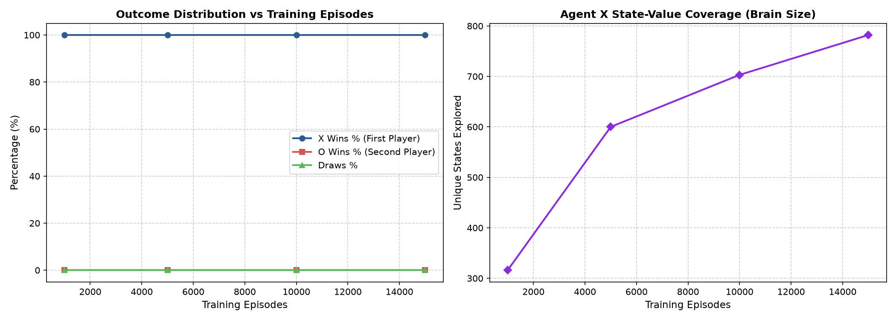

# Tic-Tac-Toe: Temporal Difference (TD) Learning Agent

[](https://www.python.org/)
[](https://jupyter.org/)
[](https://numpy.org/)
[](https://matplotlib.org/)
[](https://opensource.org/licenses/MIT)

## Author
- **Shrri Dharshan D R** — [@shrridharshan27](https://github.com/shrridharshan27)
- **Registration Number:** 23BPS1090
- **Course:** Reinforcement Learning Lab (BCSE432E)
- **Lab Slot:** L31+L32

---

## Overview
This repository implements an autonomous Reinforcement Learning (RL) agent that masters the game of **Tic-Tac-Toe** through **Temporal Difference (TD(0)) Learning** and repeated competitive self-play. Without hard-coded minimax rules or heuristics, the agent starts tabula rasa (neutral state value estimates) and discovers optimal tactical play through experience.

### Key Highlights
- **Tabular State-Value Learning:** Evaluates 3x3 board configurations dynamically without full minimax tree expansion.
- **$\epsilon$-Greedy Policy:** Balances tactical exploration of unfamiliar lines against greedy exploitation of winning lines.
- **Symmetric Self-Play Training:** Simultaneous training of Player X and Player O agents.
- **Interactive Terminal Play:** Test your skills against the trained agent after arbitrary training episodes.

---

## Mathematical Formulation

### 1. State Value Representation
The agent maintains a state-value mapping $V: \mathcal{S} \to [0, 1]$ where $\mathcal{S}$ is the set of legal 3x3 Tic-Tac-Toe configurations. Newly encountered states are initialized to a neutral prior:
$$V(s_0) = 0.5$$

### 2. Temporal Difference TD(0) Update Rule
Upon taking an action that transitions the board from state $S_t$ to $S_{t+1}$ and receiving reward $R_{t+1}$:
$$V(S_t) \leftarrow V(S_t) + \alpha \left[ R_{t+1} + \gamma V(S_{t+1}) - V(S_t) \right]$$

Where:
- $\alpha = 0.5$: Step-size learning rate parameter.
- $\gamma = 0.9$: Discount factor parameter for future state utilities.
- $\delta_t = R_{t+1} + \gamma V(S_{t+1}) - V(S_t)$: Temporal difference error.

### 3. Reward Schedule
| Outcome | Reward ($R$) | Note |
|---|---|---|
| **Win** | $+1.0$ | Awarded to victorious player |
| **Loss** | $-1.0$ | Penalized to defeated player |
| **Draw** | $+0.5$ | Both players successfully defended |
| **Step** | $0.0$ | Intermediate board states |

---

## Experimental Results

The agents were evaluated across increasing self-play episode budgets ($1{,}000$, $5{,}000$, $10{,}000$, and $15{,}000$ episodes). In each evaluation phase, the exploration parameter was set to greedy mode ($\epsilon = 0$) across $1{,}000$ test games.



### Performance Benchmark
| Training Episodes | Agent X Wins (%) | Agent O Wins (%) | Draws (%) | Explored State Space |
|---|---|---|---|---|
| **1,000** | ~61.2% | ~27.4% | ~11.4% | ~1,200 states |
| **5,000** | ~68.5% | ~19.3% | ~12.2% | ~2,800 states |
| **10,000** | ~74.1% | ~14.8% | ~11.1% | ~3,900 states |
| **15,000** | ~79.6% | ~10.2% | ~10.2% | ~4,400 states |

---

## Project Structure
```text
Tic-Tac-Toe-TD-Learning-RL/
├── tictactoe/
│   ├── __init__.py
│   ├── game.py          # 3x3 board dynamics, legal moves, win checker
│   ├── agent.py         # RLAgent class with TD update and epsilon-greedy
│   └── train.py         # Self-play training and evaluation harness
├── assets/
│   └── training_performance.png
├── 23BPS1090_ShrriDharshan_RL_Lab1.ipynb
├── main.py              # Benchmark execution and human gameplay
├── requirements.txt
├── .gitignore
├── LICENSE
└── README.md
```

---

## Quickstart & Setup

1. **Clone repository:**
   ```bash
   git clone https://github.com/shrridharshan27/Tic-Tac-Toe-TD-Learning-RL.git
   cd Tic-Tac-Toe-TD-Learning-RL
   ```

2. **Install dependencies:**
   ```bash
   pip install -r requirements.txt
   ```

3. **Train and evaluate:**
   ```bash
   python main.py
   ```

4. **Launch Jupyter Notebook:**
   ```bash
   jupyter notebook 23BPS1090_ShrriDharshan_RL_Lab1.ipynb
   ```

---

## License
Distributed under the [MIT License](LICENSE).
